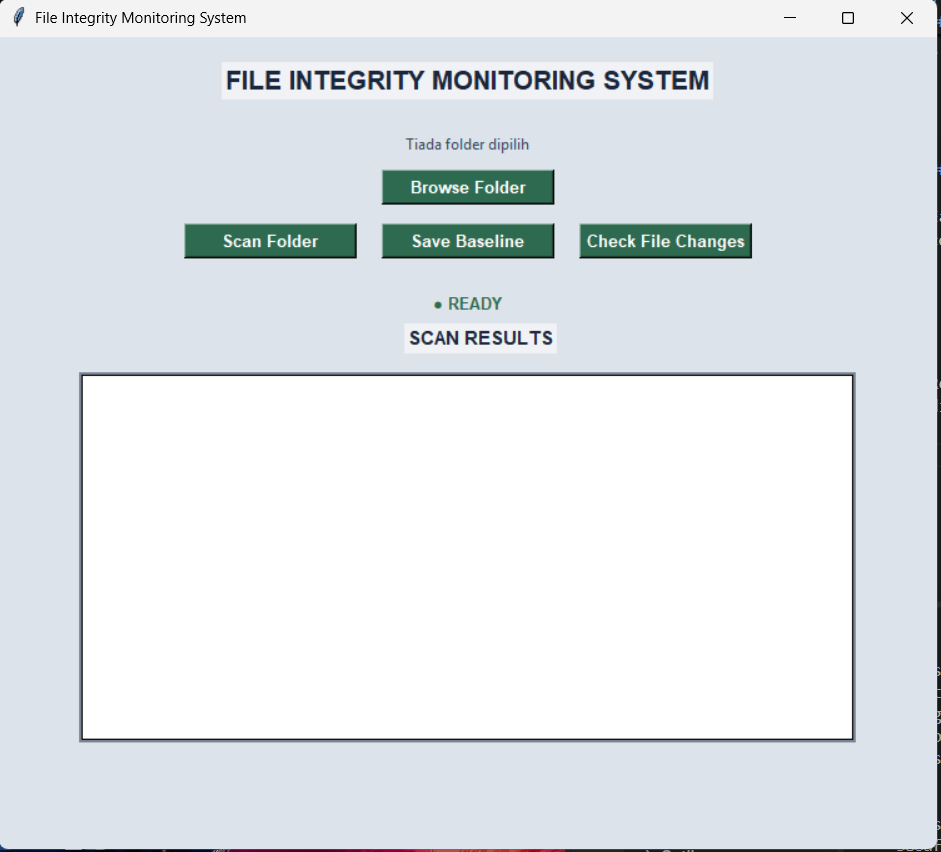

# File Integrity Monitoring System (FIMS)

## Project Description

FIMS is a Python-based application designed to monitor file integrity using SHA-256 hashing.

It detects changes in files by comparing their current hash values with previously saved baseline data.

## Application Preview


## Features

- Select a folder using the Browse Folder button.
- Scan files in the selected folder.
- Generate SHA-256 hashes for files.
- Save file information as a baseline.
- Detect new, modified, and deleted files.
- Identify unchanged files.
- Generate timestamped reports for each file check.

## Technologies Used

- **Python** – Main programming language.
- **Tkinter** – Graphical User Interface (GUI).
- **Hashlib** – Generates SHA-256 hashes.
- **OS** – Handles file and folder operations.
- **JSON** – Stores baseline data.
- **Datetime** – Generates timestamps for reports.

## How It Works

1. Select a folder using the Browse Folder button.
2. Scan the folder to calculate SHA-256 hashes.
3. Save the current file hashes as a baseline.
4. Check the folder again to compare current hashes with the baseline.
5. Display detected changes and generate a report.

## How to Run

1. Clone this repository:
   ```bash
   git clone https://github.com/irfnn09/File-Integrity-Monitoring-System.git
   ```

2. Open the project folder:
   ```bash
   cd File-Integrity-Monitoring-System
   ```

3. Run the application:
   ```bash
   python main.py
   ```

## Reports

Each file check generates a separate text report containing:

- Date and time of the check.
- Selected folder location.
- Detected file changes.

Reports are automatically saved in the `reports/` directory.

